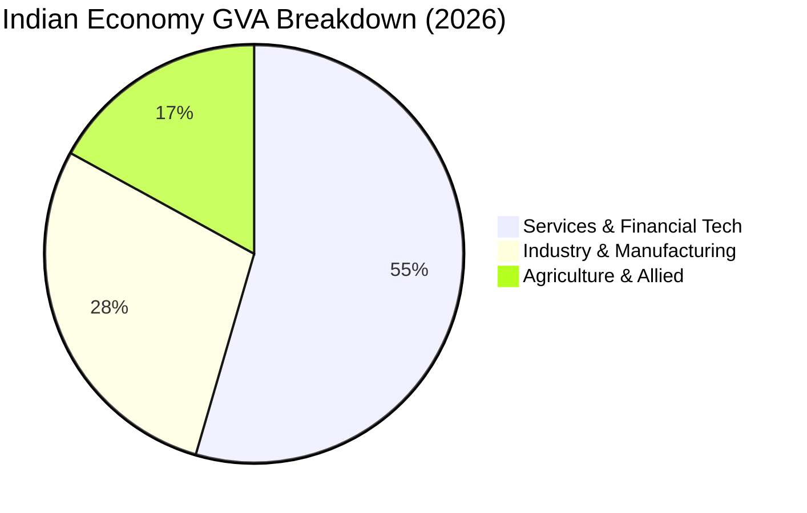
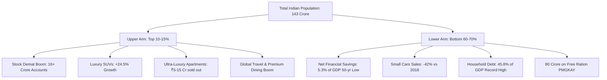

# 🔬 INVESTIGATIVE RESEARCH DOSSIER — EP-19 INDIA'S GDP 7.8% REALITY
### India's $3.94 Trillion Economy, The Per-Capita Paradox, and The 2045 Demographic Clock
> **Channel:** Benaqaab India (बेनाक़ाब इंडिया)  
> **Directive:** `SACH · SABOOT · BEBAK` (Truth · Evidence · Uncompromising)  
> **Investigative Scope:** MoSPI National Accounts, RBI Financial Stability Reports, World Bank & IMF Databases, Sectoral Chokepoints, K-Shaped Divergence, and Household Debt Trails

---

## 1. EXECUTIVE SUMMARY & INVESTIGATIVE THESIS
Every quarter, global financial headlines declare India the "fastest-growing major economy in the world," citing **7.8% Real GDP Growth**. India has crossed **$3.94 Trillion (₹330 Lakh Crore)** in nominal gross domestic product, overtaking the United Kingdom and closing in on Germany and Japan as the world's 5th largest economy.

However, a forensic examination of primary institutional data reveals a profound structural dichotomy:
1. **The Per-Capita Grand Illusion:** While India ranks **5th** in aggregate GDP, it languishes at **136th** in per capita income (~**$2,730 / ₹2.28 Lakh** per year). Compare this to the United States ($85,000), Germany ($54,000), and China ($13,500). India’s aggregate size is primarily driven by its massive population of 1.43 billion, not citizen wealth.
2. **The K-Shaped Consumption Divide:** The top 10% of India is experiencing an unprecedented boom: luxury car/SUV sales are up **+24.5%**, premium real estate is selling out in minutes, and stock market demat accounts have crossed 16 crore. Meanwhile, the bottom 60% faces stagnant real wages: entry-level hatchback sales have collapsed **-42%** since 2018, rural two-wheeler sales remain **-14%** below their 2019 peaks, and **80 Crore citizens (57% of the nation)** rely on free government foodgrains under PMGKAY.
3. **The Household Balance Sheet Stress:** According to the Reserve Bank of India (RBI), Indian households' **net financial savings have plunged to 5.3% of GDP** — a 50-year low compared to the historical benchmark of 8.1%. Simultaneously, household debt has spiked to a historic high of **45.8% of GDP**, with **58.2%** of retail borrowing flowing into unsecured consumption loans (personal loans, credit cards, BNPL) rather than capital creation.
4. **The "Missing Factory" Dilemma:** While the service sector (IT, finance, software) expands at **12.1%**, manufacturing remains stuck at **15.8% of GDP**, falling far short of the National Manufacturing Policy target of 25%. China leveraged manufacturing (27% of GDP) to lift 800 million citizens out of poverty. India risks premature de-industrialization.
5. **The 2045 Demographic Clock:** India's median age is **28.4 years**, with **1.1 Crore young people** entering the workforce annually. However, India's fertility rate has dropped below replacement level (2.0), meaning the demographic dividend window will slam shut by **2045**. If high-productivity industrial jobs are not created in the next 15–18 years, India faces the catastrophic prospect of **"getting old before getting rich."**

---

## 2. THE FACT LEDGER: VERIFIED PRIMARY METRICS

| Indicator / Metric | Official Figure | Source Authority | Investigative Insight |
|---|---|---|---|
| **Real GDP Growth Rate (Q1)** | **7.8%** | MoSPI National Accounts | Headline driver; outpaces China (4.3%) & US (1.5%). |
| **Real GVA Growth Rate (Q1)** | **8.2%** | MoSPI National Accounts | Reflects net production output minus taxes/subsidies. |
| **Nominal GDP Growth Rate** | **10.3%** | MoSPI National Accounts | Includes inflation factor; vital for fiscal deficit math. |
| **Total Nominal GDP** | **$3.94 Trillion** (~₹330 Lakh Cr) | IMF World Economic Outlook 2026 | 5th largest economy globally; chasing Germany ($4.6T). |
| **Global Per Capita Income Rank** | **136th** | World Bank Development Indicators | Lags behind Sri Lanka, Bhutan, Dominican Republic. |
| **India Per Capita Income** | **$2,730** (~₹2,28,000/year) | World Bank / MoSPI | USA: $85,000 (31x); China: $13,500 (5x); Germany: $54,000 (20x). |
| **Services Sector Growth (Fin/RE/IT)** | **12.1%** | MoSPI GVA Breakdown | Concentrated in top tier cities (Bengaluru, Mumbai, Gurugram). |
| **Manufacturing Sector Share** | **15.8% of GDP** | MoSPI / DPIIT | Government 'Make in India' target is 25%; China is 27%. |
| **Agriculture Workforce Share** | **45.4% of total workers** | PLFS (Periodic Labour Force Survey) | Employs 45% of Indians but produces only **15.0% of GDP**. |
| **Net Household Financial Savings** | **5.3% of GDP** | RBI Household Financial Assets Report | 50-year low; down from 11.5% in 2020-21 and 8.1% normal. |
| **Household Debt to GDP** | **45.8% of GDP** | RBI Financial Stability Report 2026 | All-time historical high; retail loans surging. |
| **Unsecured Consumption Loan Share** | **58.2% of bank retail loans** | RBI Credit Disaggregation | Indians borrowing for living costs, EMIs, and daily expenses. |
| **Luxury SUV Sales Growth** | **+24.5% YoY** | SIAM Automobile Flash Reports | Premium auto segment experiencing runaway boom. |
| **Entry-Level Small Cars vs 2018** | **-42.0% decline** | SIAM Automobile Flash Reports | Maruti Alto, WagonR segment shrinking drastically. |
| **PMGKAY Free Foodgrain Recipients** | **80.0 Crore Citizens** | Ministry of Consumer Affairs, Food & PDS | Budget: ₹2.05 Lakh Crore/year; shows rural income precarity. |
| **Youth Entering Job Market Yearly** | **1.10 Crore (11 Million)** | Ministry of Labour & Employment / PLFS | High supply; formal manufacturing job creation: ~20-25 lakh. |
| **Median National Age** | **28.4 Years** | UN Population Prospects 2026 | Golden demographic window; peaks around 2038–2045. |

---

## 3. SECTORAL DISSECTION: THE STRUCTURAL IMBALANCE

### A. The Agriculture Paradox
- **45.4% of India’s labor force** works in agriculture and allied activities.
- However, agriculture generates only **15.0% to 17.0% of National GVA**, growing at a modest **3.6%**.
- **Per-worker productivity** in agriculture is roughly 1/6th of services. When 65 crore people depend on a sector generating only 1/6th of national wealth, rural distress and reliance on PMGKAY free foodgrains become structural inevitabilities.

### B. The Manufacturing Deficit ("The Missing Factory")
- Historic development models (Japan in the 1960s, South Korea in the 1970s, China from 1990 to 2015) moved tens of millions of low-skilled farm workers into mass-employment manufacturing plants (textiles, electronics assembly, toys, machine tools).
- India skipped this industrial step, leaping directly from an agrarian economy to a software/services economy.
- Services generate immense value per capita, but they require English fluency, advanced college degrees, and technical skills, employing only ~30% of the workforce.
- India's manufacturing share has hovered between **14% and 16% for three decades**, unable to absorb the 1.1 crore rural youth migrating to cities every year.

---

## 4. THE K-SHAPED ECONOMY: ANATOMY OF TWO INDIAS

### The SIAM Automotive Evidence:
The automobile sector is India's most honest economic mirror:
1. **The Premium Boom:** SUVs priced above ₹15 Lakh to ₹50 Lakh (Mahindra Scorpio-N, XUV700, Hyundai Creta, Tata Safari, Toyota Fortuner, Mercedes) saw sales jump **+24.5%** in the past 24 months. Waiting periods stretch up to 6–9 months.
2. **The Mass Collapse:** Entry-level small cars priced under ₹6 Lakh (Maruti Alto, S-Presso, Renault Kwid) plummeted by **-42%** compared to 2018 peak volumes. The entry-level buyer has been priced out of personal mobility by inflation, insurance costs, and stagnant entry-level wages.
3. **The Two-Wheeler Signal:** 100cc–125cc motorcycles (Hero Splendor, Bajaj Platina) — the lifeblood of rural transport — remain **-14% below** their 2018–19 pre-pandemic peak.

---

## 5. THE HOUSEHOLD BALANCE SHEET CRISIS: THE RBI EVIDENCE

The Reserve Bank of India’s official monthly bulletin and Financial Stability Report (FSR) contain the most alarming warning lights for the Indian consumer:

### A. Net Financial Savings Collapse
- **Historical Benchmark:** Indian families traditionally saved between **7.5% and 8.5% of GDP** in bank fixed deposits, provident funds, and insurance.
- **The Current Crash:** Net financial savings have plunged to **5.3% of GDP** in the latest reported cycles.
- **Why?** Families are dipping into lifetime savings to meet everyday cost-of-living surges in healthcare, education, rent, and food inflation.

### B. Unsecured Retail Borrowing Binge
- Total Household Debt has reached an all-time peak of **45.8% of GDP**.
- Crucially, this debt is not concentrated in wealth-generating housing mortgages. Over **58.2% of non-mortgage retail loans** consist of:
  - Personal Loans (used for medical bills, weddings, and debt repayment).
  - Credit Card Rollovers and BNPL (Buy Now Pay Later) micro-credit.
  - Two-wheeler and consumer durable financing.
- The average urban middle-class household is leveraging tomorrow’s income simply to maintain today’s consumption baseline.

---

## 6. THE GLOBAL COMPARATIVE BENCHMARK: TOTAL VS PER CAPITA

| Country | Aggregate GDP (USD) | Global Rank (Total) | Per Capita Income (USD) | Global Rank (Per Capita) | Manufacturing % |
|---|---|---|---|---|---|
| **United States** | $29.1 Trillion | #1 | **$85,300** | #6 | 11.2% |
| **China** | $18.6 Trillion | #2 | **$13,500** | #68 | **27.4%** |
| **Germany** | $4.65 Trillion | #3 | **$54,200** | #19 | 18.5% |
| **Japan** | $4.18 Trillion | #4 | **$34,100** | #32 | 19.8% |
| **India** | **$3.94 Trillion** | **#5** | **$2,730** | **#136** | **15.8%** |
| **United Kingdom** | $3.58 Trillion | #6 | **$51,800** | #21 | 8.8% |

---

## 7. THE 2045 DEMOGRAPHIC CLOCK: THE WINDOW IS CLOSING
- India's median age is **28.4 years**, making it one of the youngest societies on earth.
- However, according to the National Family Health Survey (NFHS-5), India’s Total Fertility Rate (TFR) has already fallen to **2.0** — below the demographic replacement level of 2.1.
- In states like Kerala, Tamil Nadu, and Punjab, fertility has dropped to 1.5–1.6 (comparable to parts of Europe).
- **The Math:** India's workforce will peak between **2038 and 2045**, after which the dependency ratio will reverse, and elderly populations will swell.
- **The Core Threat:** If India does not build an industrial job base that elevates per capita income from $2,730 to over $10,000 by 2045, India will enter old age with developing-world public healthcare, minimal pensions, and depleted household savings.

---

## 8. THE POLICY ROADMAP & CITIZEN VERDICT
To transform 7.8% headline GDP into universal citizen prosperity, four non-negotiable structural pivots must occur:
1. **Aggressive Mass-Manufacturing Focus:** Replicate Vietnam and Taiwan in labor-intensive sectors (garments, footwear, electronics assembly, food processing) through streamlined labor compliances and plug-and-play industrial corridors.
2. **Agricultural Value Chain Revolution:** Shift farm labor into local agro-processing, cold storage logistics, and horticulture cooperatives to double rural per-capita value addition.
3. **Restructuring Household Taxation:** Provide middle-class tax relief on essential expenditures (health insurance 18% GST removal, higher deductions on education and basic savings).
4. **Vocational Skilling Over Sterile Degrees:** Align ITI and polytechnic curriculums directly with semiconductor assembly, electric vehicle fabrication, precision tooling, and global supply chains.
